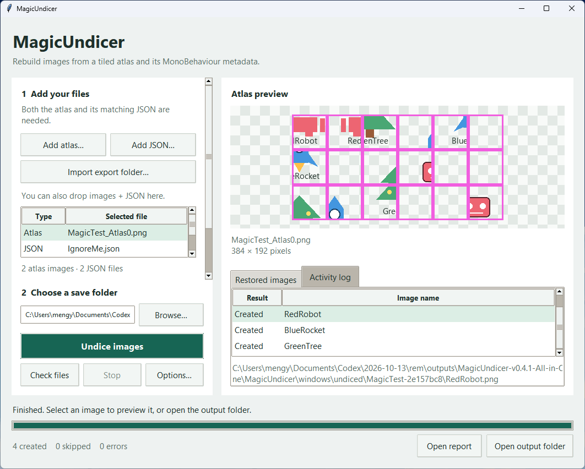

# MagicUndicer

A GUI/CLI for a image unpack from the units back to images.
Download it on [here](https://github.com/kitzure/MagicUndicer/releases)

# How does it works

From AssetStudio, export the **Texture2D atlas images** and the matching **MonoBehaviour as JSON**. You can use `.json` or a `.txt` containing valid JSON. Atlases may be PNG, JPEG, WebP, TGA, BMP, or TIFF; matching uses the image filename without its extension. Lossless atlas exports preserve pixels best.

The JSON must contain `cellSize`, `padding`, and `textureDataList`. Each image record needs `name`, `atlasName`, `width`, `height`, `cellIndexList`, and optionally `transparentIndex` (default `-1`). For example:

```json
{
  "cellSize": 64,
  "padding": 3,
  "textureDataList": [{
    "name": "fg_example_0",
    "atlasName": "fg_example_Atlas0",
    "width": 58,
    "height": 58,
    "cellIndexList": [0],
    "transparentIndex": -1
  }]
}
```

The atlas alone does not contain the image order or original dimensions. A raw `.bundle`, serialized MonoBehaviour binary, or AssetStudio text dump is not a JSON export and is not supported by this version. Export them first.